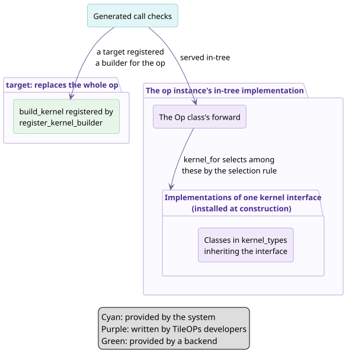

# How a backend joins TileOPs

A third-party backend joins through a target: it registers a builder for an op and takes over every call of that op. The kernel interfaces and call specs of TileOPs' ops are not public API, so a backend does not add an implementation to a single kernel interface.

## 1. What a target serves and what the in-tree implementations serve {#choose}



**Figure 1** The range a target serves and the range the in-tree implementations serve. Teal marks the parts provided by the system, purple the parts written by TileOPs developers, and green the parts provided by the backend.

**Table 1** What a target covers

| No. | Item | target |
| --- | --- | --- |
| 1 | What changes | every call of the op, except calls whose written tensors are all empty |
| 2 | Applies to | the op instances that select the target |
| 3 | Contract followed | the op's signature in the manifest |

## 2. Replace a whole op: target {#target}

The full target protocol, a runnable template backend, and common errors are in [Adding a hardware backend](../../backends.md). This section only summarizes it.

A target is a name a backend gives to a set of kernels. Once a target registers a builder for an op, every call of an op instance that selects the target is served by the target, and the op's own `forward` does not run. The exception is a call whose written tensors are all empty: then neither the target nor the in-tree implementation runs, and the outputs are constructed from the signature.

```python
from tileops.backend import TensorSpec, register_detector, register_kernel_builder
from .kernels import AcmeRMSNorm

register_detector(target="acme", detect=lambda device: device.type == "acme")

def build_rms_norm(x: TensorSpec, weight: TensorSpec | None, *, normalized_shape, eps):
    return AcmeRMSNorm(normalized_shape, eps, x.dtype)

register_kernel_builder(op="RMSNormFwdOp", target="acme", build_kernel=build_rms_norm)
```

- `build_kernel` receives a `TensorSpec` for each input in the order of the op's `signature.inputs` (an optional input that is not passed is `None`, such as `RMSNormFwdOp`'s `weight`), and receives `signature.params` as keywords. The kernel it returns receives the input tensors in the same order at call time, and receives the output buffers and execution arguments the caller passes as keywords. Importing the module compiles nothing; building happens when `build_kernel` is called.
- The kernel returned may define the optional members `request_tune()` and `config`, which mean the same as on an in-tree `Kernel`; see [Adding a hardware backend § build_kernel](../../backends.md#build-kernel).
- An op instance caches the kernels returned by `build_kernel` by the call's device, and by whether each input is passed, its dtype, and its shape.
- An op instance fixes its target on the first call that needs to run an implementation, and the target does not change afterwards. The construction argument `target=` comes first, then the process default set by `set_default_target`, and finally each target's detector inspects the call's device. When no target claims the device, the in-tree implementation is used; when several targets claim it, the call raises `AmbiguousTargetError`. A call whose written tensors are all empty does not fix the target. When the call that fixes the target fails, the choice is undone and the next call fixes it again.
- A call passed to a target has already passed the checks generated from the signature. Every tensor is on the call's device, except tensors declared `device: cpu`. Every input that is not written is contiguous, and a written input is contiguous when it declares `contiguous: true`.
- When the selected target has registered no builder for this op and the op holds kernels of its own, the call raises `OpNotAvailableError` and does not fall back to the in-tree implementation.

Registration happens when the backend module is imported. The backend declares an entry point in `pyproject.toml`, and TileOPs imports it when the first op is constructed:

```toml
[project.entry-points."tileops.backends"]
acme = "tileops_acme"
```

When the module fails to import, all its registrations are undone and TileOPs emits a `RuntimeWarning`. The failure records are available through `tileops.backend.load_failures()`.
